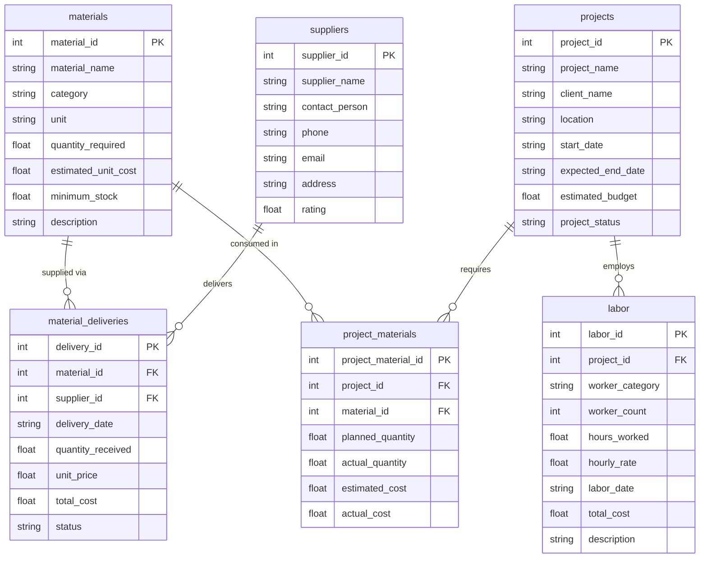

# Construction Material Inventory & Structural Cost Estimation System

[](https://www.python.org/)
[](https://www.sqlite.org/)
[](https://streamlit.io/)
[](https://pandas.pydata.org/)
[](https://colab.research.google.com/)

An academic, production-grade relational database project designed to assist civil engineering managers, site quantity surveyors, and project directors in tracking material procurements, vendor billings, site labour expenses, and project budgets.

---

## 1. Project Title
**Construction Material Inventory & Structural Cost Estimation System**

---

## 2. Overview
This application utilizes a normalized SQLite database (`construction_cost_estimator.db`), Python, Pandas, Plotly, and Streamlit to store structured construction data, execute SQL queries, calculate project expenses, and generate real-time cost variance reports.

The database is created automatically upon execution and runs self-sufficiently in **Google Colab** or any local Python environment with **zero external database server setup** (no MySQL, PostgreSQL, XAMPP, or Docker required).

---

## 3. Problem Statement
Construction projects require tracking multiple materials, vendors, deliveries, daily labour shifts, and project budgets. Maintaining these records manually in spreadsheets leads to:
* Data redundancy and transcription errors.
* Inventory stock-outs of critical materials (e.g., Cement, Steel).
* Double-counting procurement orders alongside on-site material consumption.
* Delayed detection of budget deficits until after project completion.

This system replaces fragmented spreadsheets with an ACID-compliant relational database that automates cost tracking, prevents double counting, and provides real-time budget forecasting.

---

## 4. Objectives
* Design and deploy an SQLite database enforcing Primary Keys, Foreign Keys, and CHECK constraints.
* Seed realistic Indian construction data with illustrative pricing in Indian Rupees (INR - ₹).
* Execute 44 comprehensive SQL queries (Aggregations, Grouping, HAVING, Joins, Subqueries, CASE).
* Implement real-time physical inventory tracking ($\sum \text{Delivered} - \sum \text{Consumed}$).
* Automate project budget forecasting with three health classifications (<80%, 80-100%, >100%).
* Build an interactive Streamlit dashboard (`app.py`) with Plotly visualizations.
* Export analytical database audit reports to CSV.

---

## 5. Features
* **Zero-Configuration SQLite Engine:** Runs directly using Python's built-in `sqlite3` module.
* **Strict Referential Integrity:** Foreign keys enabled on every connection (`PRAGMA foreign_keys = ON;`).
* **11 Dashboard Modules:** Dashboard, Projects, Materials, Suppliers, Deliveries, Labour, Inventory, Cost Analysis, Budget Forecast, SQL Reports, and About.
* **Comprehensive CRUD Functionality:** Forms with validation for adding, updating, and deleting records.
* **Budget Health Gauges:** Visual indicators flagging projects that are Within Budget, Near Limit, or Over Budget.
* **Inventory Depletion Alerts:** Immediate warnings when physical stock falls below minimum thresholds.
* **One-Click CSV Reports:** Automated generation and download of 6 analytical audit spreadsheets.

---

## 6. Technology Stack
* **Programming Language:** Python 3.10+
* **Database Management System:** SQLite 3 (Built-in `sqlite3` module)
* **Data Processing & Analysis:** Pandas
* **Data Visualization:** Plotly Express & Plotly Graph Objects
* **Web User Interface:** Streamlit
* **Development Environment:** Google Colab / Local Terminal / VS Code
* **Data Export:** CSV

---

## 7. Database Design
The relational schema consists of **6 normalized tables** designed to Third Normal Form (3NF):

```
+---------------+       1:N       +---------------------+
|   suppliers   | --------------< | material_deliveries |
+---------------+                 +---------------------+
                                             |
                                             | M:1
                                             v
+---------------+       1:N       +---------------------+
|   materials   | --------------< |  project_materials  |
+---------------+                 +---------------------+
                                             |
                                             | M:1
                                             v
+---------------+       1:N       +---------------------+
|   projects    | --------------< |        labor        |
+---------------+                 +---------------------+
```

---

## 8. Entity-Relationship (ER) Diagram



---

## 9. Table Descriptions

1. **`materials`**: Stores civil catalog specifications, categories, units, baseline unit costs, and safety stock thresholds.
2. **`suppliers`**: Stores vendor profiles, contact information, yard addresses, and performance ratings (0.0 to 5.0).
3. **`projects`**: Stores construction ventures, client names, locations, schedules, sanctioned budgets, and statuses.
4. **`material_deliveries`**: Stores procurement orders, delivery dates, received quantities, unit prices, total costs, and statuses (`Delivered`, `Pending`, `Partially Delivered`).
5. **`labor`**: Records site contractor work shifts, worker trades, headcounts, hours worked, and hourly wage rates.
6. **`project_materials`**: Connects projects with planned baseline vs actual material consumption (`UNIQUE(project_id, material_id)`).

---

## 10. SQL Concepts Demonstrated
* **Basic DML:** `SELECT`, `INSERT`, `UPDATE`, `DELETE`, `WHERE`, `ORDER BY`, `DISTINCT`, `LIMIT`.
* **Logical Filtering:** `AND`, `OR`, `NOT`, `IN`, `BETWEEN`, `LIKE`, `IS NULL`.
* **Aggregate Functions:** `COUNT()`, `SUM()`, `AVG()`, `MIN()`, `MAX()`.
* **Grouping & Conditions:** `GROUP BY`, `HAVING`.
* **Relational Joins:** `INNER JOIN` (multi-table linking) and `LEFT JOIN` (identifying zero-order vendors).
* **Advanced Queries:** Scalar subqueries, Common Table Expressions (CTEs), conditional `CASE` expressions, and atomic transactions.

---

## 11. Cost Calculation Formulas
* **Material Delivery Cost:**
  $$\text{Total Cost} = \text{Quantity Received} \times \text{Unit Price}$$
* **Site Labour Wage Cost:**
  $$\text{Labour Cost} = \text{Worker Count} \times \text{Hours Worked} \times \text{Hourly Wage Rate}$$
* **Actual Project Cost:**
  $$\text{Actual Project Cost} = \sum \text{Actual Material Cost} + \sum \text{Actual Labour Cost}$$
* **Remaining Budget:**
  $$\text{Remaining Budget} = \text{Estimated Budget} - \text{Actual Project Cost}$$
* **Cost Variance:**
  $$\text{Cost Variance} = \text{Actual Project Cost} - \text{Estimated Budget}$$
  *(Positive = Cost Overrun, Negative = Under Budget, Zero = Exact Match)*

---

## 12. Inventory Calculation Logic
* **Total Received:** Sum of `quantity_received` for deliveries where `status = 'Delivered'`.
* **Total Consumed:** Sum of `actual_quantity` from `project_materials`.
* **Current Physical Stock:**
  $$\text{Current Physical Stock} = \text{Total Received} - \text{Total Consumed}$$
* **Stock Health Classifications:**
  * **Out of Stock:** $\text{Current Stock} \le 0$
  * **Low Stock:** $\text{Current Stock} < \text{minimum\_stock}$
  * **Requirement Completed:** $\text{Total Received} \ge \text{quantity\_required}$
  * **Available:** Normal operating condition

---

## 13. Budget Forecasting
Projects are evaluated using the Budget Utilization Ratio:
$$\text{Budget Utilization \%} = \left(\frac{\text{Actual Project Cost}}{\text{Estimated Budget}}\right) \times 100$$
Evaluated dynamically using an SQL `CASE` statement:
* **Below 80% Utilization:** 🟢 **Within Budget**
* **80% to 100% Utilization:** 🟡 **Near Budget Limit**
* **Above 100% Utilization:** 🔴 **Over Budget (Overrun Alert)**

---

## 14. Google Colab Setup
1. Open [Google Colab](https://colab.research.google.com/).
2. Click **File** $\rightarrow$ **Upload notebook** and upload `construction_cost_estimator.ipynb`.
3. Select **Runtime** $\rightarrow$ **Change runtime type** $\rightarrow$ Python 3.
4. Run all cells sequentially from top to bottom.

---

## 15. How to Execute the Notebook
* **Step 1:** Run Cell 4 to install `pandas`, `plotly`, and `streamlit`.
* **Step 2:** Run Cells 5–13 to create tables and seed realistic Indian construction records.
* **Step 3:** Run Cell 14 to verify row counts and referential integrity (`PRAGMA foreign_key_check;`).
* **Step 4:** Run Cells 15–27 to execute the 44 SQL queries, compute costs, and export CSV reports.
* **Step 5:** Run Cells 28–30 to generate `app.py` and launch the Streamlit dashboard.

---

## 16. How to Launch Streamlit

### In Google Colab:
Execute in a code cell:
```bash
!streamlit run app.py & npx localtunnel --port 8501
```
Click the localtunnel URL (e.g. `https://funny-fox-42.loca.lt`). If prompted for a tunnel password, find your public IP using:
```bash
!curl ipv4.icanhazip.com
```

### On Local Machine:
1. Clone this repository or open the folder:
   ```bash
   cd construction_cost_estimator
   ```
2. Install dependencies:
   ```bash
   pip install -r requirements.txt
   ```
3. Initialize database (optional, runs automatically on startup):
   ```bash
   python db_manager.py
   ```
4. Launch the dashboard:
   ```bash
   streamlit run app.py
   ```
5. Open your browser at `http://localhost:8501`.

---

## 17. CSV Export Instructions
The system automatically generates 6 audit reports in the `reports/` folder:
1. `material_report.csv` / `material_inventory.csv`
2. `supplier_report.csv` / `supplier_spending.csv`
3. `delivery_records.csv`
4. `labor_expenses.csv`
5. `project_cost_report.csv` / `project_cost_summary.csv`
6. `budget_utilization.csv`

To download in Streamlit: Navigate to the **About** page or **SQL Reports** tab and click **Download CSV**.  
To download in Google Colab: Run `files.download('reports/project_cost_report.csv')`.

---

## 18. Screenshots Section

| Screen / Feature | Description | Suggested Capture |
| :--- | :--- | :--- |
| **Main Dashboard** | KPI metric cards and Plotly spending charts | Capture top KPI row and category donut chart |
| **Budget Forecast** | Project health gauge showing 114.4% overrun | Capture Sunrise Residential Towers red gauge |
| **Inventory Analysis** | Physical stock vs minimum safety thresholds | Capture inventory table and low-stock alert banner |
| **SQL Reports** | Live execution of query 41 (CASE statement) | Capture SQL query panel and returned DataFrame |

---

## 19. Limitations
* **Single-Process Write Lock:** SQLite allows concurrent reads but serializes write operations.
* **No Built-in Authentication:** Designed for single-tenant local/colab execution; lacks role-based access control.
* **Manual Input Reliance:** Site material usage is entered via web forms rather than automated barcode/IoT scans.

---

## 20. Future Enhancements
* Enterprise migration to PostgreSQL for distributed multi-site concurrency.
* Mobile barcode and RFID scanning integration for delivery receipt.
* Machine Learning predictive models (ARIMA) for forecasting seasonal price fluctuations of cement and steel.
* Role-Based Access Control (RBAC) with distinct engineer and accountant permissions.

---

## 21. Conclusion
The **Construction Material Inventory & Structural Cost Estimation System** successfully demonstrates the integration of relational database engineering with construction quantity surveying. By enforcing ACID transactions, referential constraints, pre-aggregated CTE queries, and interactive Streamlit visualizations, the project eliminates expense double-counting and provides real-time budget forecasting entirely within Google Colab.
